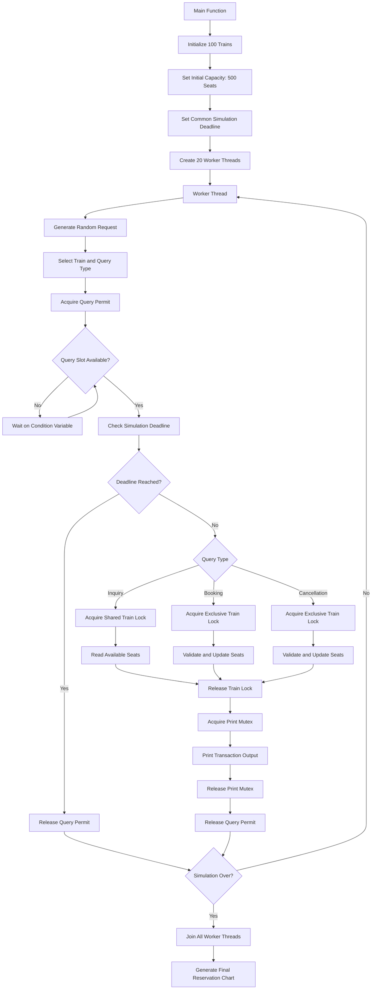

# 🚆 Railway Reservation System using Multithreading (C++)

[](https://isocpp.org/)
[](https://en.cppreference.com/w/cpp/thread)
[]()

## 📌 Project Overview

The **Railway Reservation System** is a collaborative C++ project that simulates multiple users performing railway reservation operations concurrently.

The system uses the C++ Standard Thread Library to create multiple worker threads, each representing an independent user performing seat inquiries, bookings, and cancellations across different trains.

The primary objective is to demonstrate practical implementation of **Multithreading, Thread Synchronization, Mutex Locks, Reader-Writer Locks, and Condition Variables** while maintaining data consistency during concurrent operations.

The project incorporates train-level synchronization to allow independent operations on different trains while safely managing simultaneous access to the same train.

## 🤝 Collaborative Development

This project was collaboratively developed by:

| Contributor | GitHub Profile | Repository |
|---|---|---|
| **Bharti Upkar** | [@bhartiupkar](https://github.com/bhartiupkar) | [Train_Reservation_system](https://github.com/bhartiupkar/Train_Reservation_system) |
| **Tuli Shruti (Shruti Guba)** | [@TuliShruti](https://github.com/TuliShruti) | [Train_Reservation_System](https://github.com/TuliShruti/Train_Reservation_System) |

Both contributors collaborated on the development and enhancement of the railway reservation system.

## ✨ Key Features

- **Multithreaded Execution:** Creates 20 worker threads to simulate multiple users performing reservation operations simultaneously.
- **Seat Inquiry:** Allows users to check the available seats on a randomly selected train.
- **Seat Booking:** Supports booking between 5 and 10 seats, subject to availability.
- **Booking Cancellation:** Allows cancellation of previously booked seats.
- **Reader-Writer Synchronization:** Uses shared locks for simultaneous inquiries and exclusive locks for booking and cancellation.
- **Train-Level Locking:** Maintains an independent reader-writer lock for each train.
- **Query Management:** Limits the number of admitted active queries to 5.
- **Thread-Safe Random Generation:** Uses independent random number generators for worker threads.
- **Automatic Resource Management:** Uses RAII-based query slot management.
- **Final Reservation Chart:** Displays the remaining seat availability across all trains after execution.

## 🏗️ System Architecture

The system follows a multithreaded worker-based architecture.

Each worker thread independently generates reservation requests. A query limiter controls the number of admitted operations, while individual train locks coordinate concurrent access to train seat availability.

### Architecture Flowchart



### Workflow Explanation

1. The main function initializes 100 trains, each with an initial capacity of 500 seats.
2. A common simulation deadline is established.
3. Twenty worker threads are created to simulate independent users.
4. Each worker generates a random train number and reservation request.
5. A query permit is acquired, ensuring that no more than five operations are admitted simultaneously.
6. Depending on the request type:
   - **Inquiry:** Acquires a shared lock to read seat availability.
   - **Booking:** Acquires an exclusive lock to update seat availability.
   - **Cancellation:** Acquires an exclusive lock to restore previously booked seats.
7. Transaction output is synchronized using a separate print mutex.
8. Query permits are automatically released after processing.
9. All worker threads are joined after the simulation finishes.
10. The final reservation chart displays the remaining seat availability for all trains.

## ⚙️ Concurrency and Synchronization

One of the main objectives of this project is to demonstrate safe concurrent access to shared resources.

### 1. Reader-Writer Locks (`shared_mutex`)

Each train maintains its own `shared_mutex`.

**Shared Lock – Seat Inquiry**

```cpp
shared_lock<shared_mutex> lock(train_mutex[train]);

seats = available_seats[train];
```

- Allows multiple threads to inquire about the same train simultaneously.
- Prevents booking or cancellation from modifying seat availability while an inquiry holds the lock.

**Exclusive Lock – Booking and Cancellation**

```cpp
unique_lock<shared_mutex> lock(train_mutex[train]);
```

- Ensures exclusive access when modifying seat availability.
- Prevents simultaneous modifications to the same train.
- Allows independent operations on different trains to proceed without a global reservation lock.

### 2. Query Limiter and Condition Variables

The `QueryLimiter` class manages the maximum number of admitted active queries.

```cpp
cv.wait(lock, [this]() {
    return active_queries < MAX_ACTIVE_QUERIES;
});
```

- Uses a mutex to protect the active query counter.
- Uses a condition variable to suspend threads when the query limit is reached.
- Notifies waiting threads when an active query slot is released.

### 3. RAII-Based Resource Management

The `QueryPermit` class automatically releases acquired query slots when an operation finishes.

This helps prevent query slots from remaining occupied because of forgotten manual release operations.

### 4. Thread-Safe Random Number Generation

Each worker thread maintains its own `mt19937` random number generator.

This avoids concurrent access to a shared random number generator and allows independent generation of train numbers, query types, and booking quantities.

### 5. Output Synchronization

A separate `print_mutex` protects console output, ensuring that transaction messages are printed without interleaving.

It does not protect train seat data; that responsibility belongs to the individual train locks.

## 📊 System Configuration

| Parameter | Value |
|---|---:|
| Total Trains | 100 |
| Initial Capacity per Train | 500 seats |
| Maximum Worker Threads | 20 |
| Maximum Admitted Active Queries | 5 |
| Minimum Booking Size | 5 seats |
| Maximum Booking Size | 10 seats |
| Simulation Duration | 1 minute |
| C++ Standard | C++17 |

## 🛠️ Technologies Used

| Technology | Application |
|---|---|
| C++17 | Core programming language |
| Standard Thread Library | Worker thread creation and management |
| `mutex` | Protecting shared counters and console output |
| `shared_mutex` | Reader-writer synchronization |
| `condition_variable` | Managing waiting worker threads |
| `chrono` | Simulation timing and deadlines |
| `random` | Thread-specific random number generation |

## 💻 Sample Execution Output

The following is an illustrative example of the program's output. Actual results will vary because requests and booking quantities are randomly generated.

```text
========================================
   RAILWAY RESERVATION SYSTEM
========================================
Initializing 100 trains...
Creating 20 worker threads...
Maximum active queries: 5
Simulation duration: 1 minute(s)

Thread 3: Inquiring Train 12
Thread 3: 500 seats available in Train 12

Thread 5: Booking seats in Train 24
Thread 5: booking 8 seats in Train 24
Thread 5: successfully booked 8 seats in Train 24

Thread 7: Cancelling bookings in Train 24
Thread 7: successfully cancelled 4 seats in Train 24

Thread 2: Inquiring Train 24
Thread 2: 496 seats available in Train 24

========================================
       FINAL RESERVATION CHART
========================================
Train Number    Available Seats
0               500
1               500
2               500
...
24              496
...
99              500

========================================
Thanks for using our services!
```

*Note: The output above is illustrative and is not a captured execution log.*

## 📂 Project Structure

```text
Train_Reservation_system/
│
├── README.md
└── main.cpp
```

## 🚀 Getting Started

### Prerequisites

- C++17 compatible compiler (G++ recommended).
- POSIX thread support on Linux or compatible threading support on Windows.

### 1. Clone the Repository

```bash
git clone https://github.com/bhartiupkar/Train_Reservation_system.git
```

### 2. Navigate to the Project Directory

```bash
cd Train_Reservation_system
```

### 3. Compile the Program

**Linux / macOS / MinGW:**

```bash
g++ -std=c++17 -Wall -Wextra -Wpedantic main.cpp -o train_reservation -pthread
```

### 4. Run the Program

**Linux / macOS:**

```bash
./train_reservation
```

**Windows PowerShell:**

```powershell
.\train_reservation.exe
```

## 🔮 Future Improvements

- Implement unique booking IDs and passenger information.
- Introduce persistent storage using files or a database.
- Add booking history and transaction tracking.
- Implement a user-friendly interface for reservation operations.
- Add automated unit and concurrency tests.
- Introduce performance benchmarking for different thread configurations.
- Evaluate fairness and starvation behavior of reader-writer locks.

## 🎯 Learning Outcomes

Through this project, we explored:

- Practical implementation of multithreading in C++.
- Managing concurrent user requests.
- Synchronizing access to shared resources.
- Implementing reader-writer locks.
- Using condition variables for thread coordination.
- Understanding race conditions and critical sections.
- Applying RAII for resource management.
- Designing concurrent systems with independent resource locking.

---

**Developed collaboratively by Bharti Upkar and Tuli Shruti.**

*An implementation of Multithreading, Concurrency, and Synchronization concepts using C++17.*
